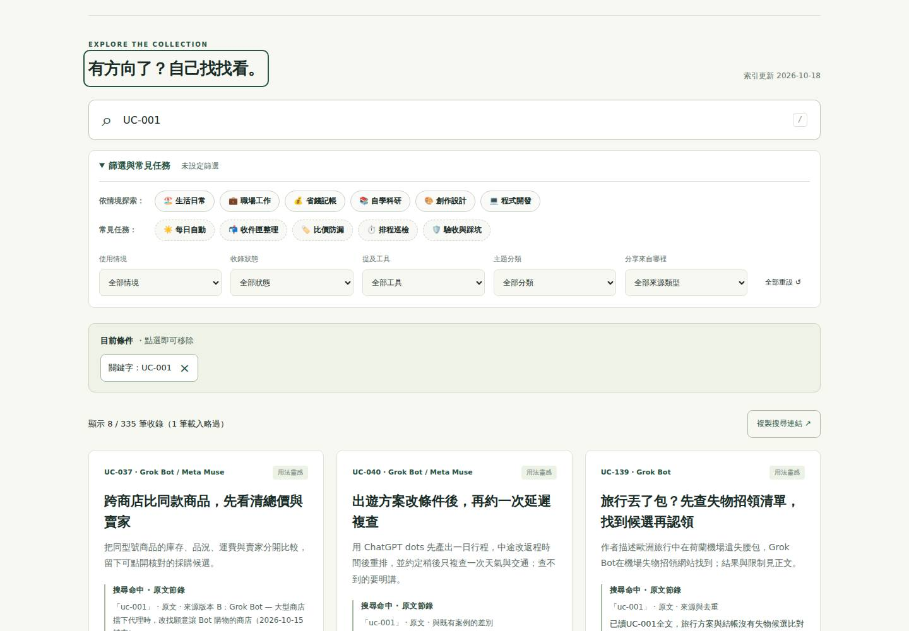
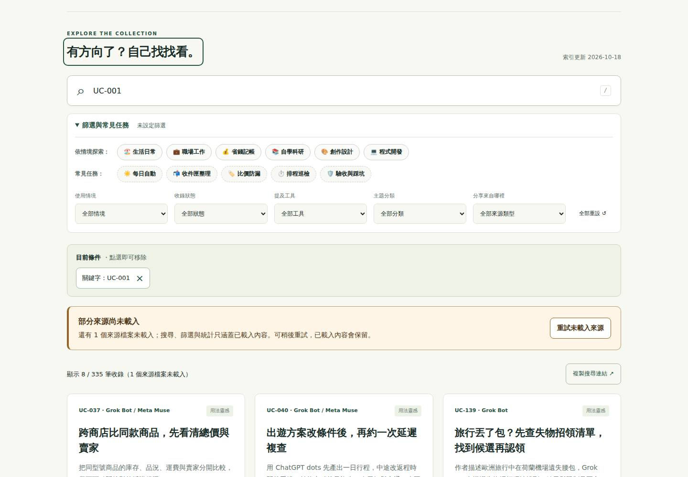
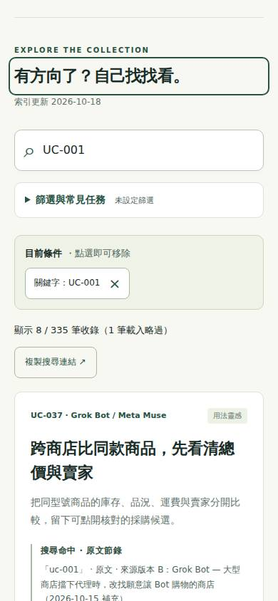
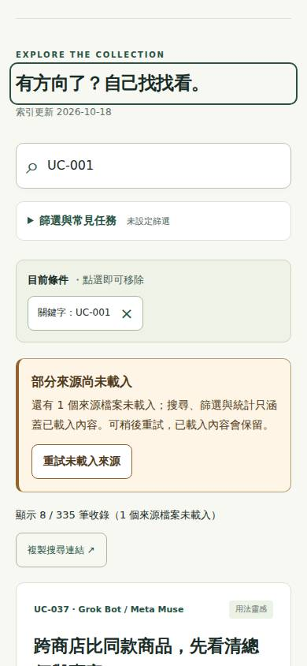

# 2026-10-18：部分載入與失敗來源恢復

## 問題、選擇與範圍

目標讀者是遇到弱網、來源暫時無法讀取或限流，卻仍想搜尋與閱讀案例的人。前次正式站驗收曾記錄 HTTP 429、71 個來源略過。本輪以現有 main `ee1bfce` 在 GitHub Ubuntu runner 重現：讓 UC-001 的 Markdown 回傳 429，桌面1440×1000與手機390×844都顯示335條目、1筆略過，沒有重試入口。這是可控故障重現，不宣稱每位訪客都遇到限流。

兩個方案：
- 整庫打包：降低首次請求量，但須改 Jekyll 產出與快取一致性，成本較高。
- 部分恢復（採用）：保留可讀內容，明確標示不完整並只重試失敗來源，成本中等。

驗收目標：失敗與成功可分次恢復；重試只讀失敗路徑；保留當下條件、分享、鍵盤焦點與正在閱讀內容；缺失案例直鏈可恢復；全失敗仍走完整初始化。手機無橫向溢出，狀態文字與按鈕可讀可操作。

不處理初次整庫打包、跨重整快取、搜尋排名、同義詞、案例研究、證據資格與去重。維持Markdown原始資料、300嚴格核對合格／336總條目分開，不新增追蹤、cookies、登入、外部產品依賴。

## 實作

- `assets/app.js`：獨立部分重試，只補失敗來源、並行4、每來源15秒逾時；按來源路徑合併以保留pending單檔多條目；更新統計與選項時保留當下條件。重試可繼續搜尋／閱讀；恢復只在失去可見節點時移轉焦點。純案例缺失直鏈遵守原有到達／不搶操作規則。
- `index.html`、`assets/style.css`：結果前的部分載入提示、重試入口與polite狀態；不完整空結果標題限定已載入範圍。卡片標籤移除會穿越低對比中間色的漸變。
- `tests/load-recovery.test.cjs`、`tests/load-recovery-browser.cjs`、`tests/load-recovery-live.cjs`：合併／逾時、跨瀏覽器完整流程與實際正式站走查。
- 原有Reader與搜尋恢復測試更新來源檔案數用語；新增唯讀權限的`Partial Load QA`沿用GitHub runner、Playwright／axe版本，PR與main自動驗證。

## 前後畫面

同一資料基準、同一UC-001來源429、同一查詢與到達位置；「後」圖為復原入口出現但尚未重試的狀態，不用成功畫面隱藏故障。

| 尺寸 | 修改前 | 修改後 |
|---|---|---|
| 桌面1440×1000 |  |  |
| 手機390×844 |  |  |

另附320px窄手機畫面與原始驗收JSON。正式網站：[AI用法實驗室](https://richardhan.github.io/ai-agent-use-cases/)。正常網路不顯示故障提示；可在Playwright攔截任一案例Markdown回傳429重現。

## 驗證

基準[39134270978](https://github.com/RichardHan/ai-agent-use-cases/actions/runs/39134270978)：31/31單元測試與語法／預覽建置成功。
先紅[39134366316](https://github.com/RichardHan/ai-agent-use-cases/actions/runs/39134366316)：31/31既有測試成功，新增瀏覽器斷言明確失敗於「Partial results must provide a visible recovery action」。

候選產品 `abef751` 的[Partial Load QA](https://github.com/RichardHan/ai-agent-use-cases/actions/runs/39135114928)：
- `node --test tests/*.test.cjs`：33 tests / 33 pass / 0 fail；JS語法與Python預覽建置成功。
- Chromium 1440／390／320px、Firefox 390px、WebKit 390px：全部三情境及邊界通過。
- 20次axe掃描零違規；各尺寸未發現橫向溢出。
- 五組瀏覽器／尺寸均由335條目補回336，只新增1個Markdown請求；沒有重抓其餘已成功來源或索引。
- 已實際檢視桌面、手機與窄手機前後截圖。
- [Website QA](https://github.com/RichardHan/ai-agent-use-cases/actions/runs/39135114924)、[Search context QA](https://github.com/RichardHan/ai-agent-use-cases/actions/runs/39135114967)通過。

同一雲端job也實際開啟當時正式站首頁、搜尋旅遊＋Grok Bot、案例詳情、展開全文、Markdown原文與來源索引、返回結果及空結果：桌面／手機皆336條目、零略過、17筆相同結果、無pageerror，來源索引HTTP200。未宣稱逐一驗證全部外部來源。該次正式站尚未含本輪功能（recoveryUI=false）；載入完成樣本2355／2302ms為未節流runner單次觀測，非LCP或速度改善對照。合併後另由main QA比對實際瀏覽器收到的新版JS/CSS，確認部署。

[原始跨瀏覽器數據](verification.json) · [正式站基準數據](live-baseline.json) · [PR #46](https://github.com/RichardHan/ai-agent-use-cases/pull/46)

三種模擬情境（非真人研究）：
1. 部分來源失敗，搜尋只存在失敗來源的工具 → 分次重試 → 重試中修改關鍵字 → 保留條件與結果卡焦點；pending一檔補回兩筆。
2. 開啟純案例直鏈但來源失敗 → 到搜尋恢復區 → 滑鼠重試 → 原URL開啟案例 → 返回／重整。
3. 重試中開啟另一則案例 → 完成後不打斷閱讀／不重開舊案例 → 返回原卡片。另測空結果控制項隱藏、手動分享、全來源失敗與完整重試。

指令（僅在雲端runner執行）：

```sh
node --test tests/*.test.cjs
node --check assets/app.js
node --check assets/reader.js
python3 scripts/preview.py /tmp/load-preview/ai-agent-use-cases
python3 -m http.server 8086 --directory /tmp/load-preview
NODE_PATH=<cloud-tools>/node_modules LOAD_ENGINES=all node tests/load-recovery-browser.cjs
NODE_PATH=<cloud-tools>/node_modules node tests/load-recovery-live.cjs
```

沒有獨立lint、TypeScript或npm build；Python預覽不等於正式Jekyll。發布後另查Pages建置及瀏覽器實際收到的JS/CSS。

## 獨立審查與限制

由未負責實作的獨立角色檢查，主代理唯一整合。已修正全失敗時誤露部分入口、隱藏控制焦點、手動分享保留、滑鼠直鏈恢復，並補純案例到達。驗收工具曾因axe要求顯式context與Resource Timing預設緩衝容量而失敗，已修測試，不當成產品結果；請求量改用瀏覽器request事件。返回流程另真實抓到標籤漸變對比1.16:1，移除漸變後重驗。新提示色值#513b20／#fff5e6計算對比9.75:1。

首次仍逐檔載入；本輪只降低恢復成本，不宣稱改善初次LCP或已杜絕429。尚未驗證實體手機、螢幕閱讀器或真人成效；axe零違規不等於完整無障礙認證。

主代理實際模型／推理與帳號最高選項無讀取或切換介面，未宣稱最強；獨立審查指定`gpt-6-astra / ultra`。起始讀取一次本機技能文件後，所有repository讀寫與測試均透過GitHub連線／既有雲端runner；沒有操作本機GUI或修改本機工作樹，也無法確認其未提交內容。遠端樹無AGENTS.md；以README／SITE與現有流程為準。沒有額外API、購買額度、reset或強推。

下一輪：以初次載入請求數與部署一致性為驗收，評估Jekyll產生單一全文資料包。

## 合併後驗收與測試準備修正

PR #46 已合併為 `bbacfb0`，正式[Pages建置部署](https://github.com/RichardHan/ai-agent-use-cases/actions/runs/39135631604)成功。[main Partial Load QA](https://github.com/RichardHan/ai-agent-use-cases/actions/runs/39135632154)、[Search context QA](https://github.com/RichardHan/ai-agent-use-cases/actions/runs/39135632182)與[Website QA](https://github.com/RichardHan/ai-agent-use-cases/actions/runs/39135632146)通過。雲端桌面／手機瀏覽器實際收到的JS/CSS與該版本完全相符，皆336條目、零失敗、旅遊＋Grok Bot共17結果，詳情、原文／來源索引、返回與空結果通過，無pageerror。見[正式部署數據](live-deployed.json)。載入完成1120／462ms只是單次runner觀測，不宣稱速度改善。

[Reader QA](https://github.com/RichardHan/ai-agent-use-cases/actions/runs/39135632150)的原執行與一次重跑皆失敗於原有延遲載入／人工捲動流程：第一次載入後279≠100；第二次在釋放catalog前280≠100。保留失敗紀錄，不將重跑當成首次通過。合併前同產品版本的[Reader QA](https://github.com/RichardHan/ai-agent-use-cases/actions/runs/39135114953)及[文件完成後Reader QA](https://github.com/RichardHan/ai-agent-use-cases/actions/runs/39135444251)曾通過，但這本身不證明沒有問題。

[隔離雲端對照](https://github.com/RichardHan/ai-agent-use-cases/actions/runs/39136378775)使用同Firefox／runner、固定Math.random、390×844、reducedMotion，每組6個全新context：
- 本輪前 `ee1bfce`＋原準備：5/6；基準同樣在catalog解除前出現280，解除後279。
- 本輪前＋等待焦點捲動穩定：6/6。
- 最新 `02d925f`＋原準備：6/6。
- 最新＋等待焦點捲動穩定：6/6。

失敗trace只有測試一次scrollTo(100)，沒有應用scrollIntoView；焦點仍filter-summary、allowAutomaticArrival=false、computed scrollBehavior=auto。這證明原產品也可重現準備時序問題；不把每一個過去失敗都斷言為同一原因。完整[24次原始紀錄](scroll-diagnostic.json)保留。

因此 `tests/arrival-browser.cjs`只在Tab之後、人工scrollTo之前，等待焦點不變、可見且位置／頁面高度連續200ms穩定（最多5秒，逾時失敗）。保留一次scrollTo(100)、載入前後兩個精確100斷言；沒有載入後補捲動、改目標或放寬容差。獨立審查確認此修正範圍。完整Reader回歸另以收尾PR檢查為準。

收尾期間協作者合併 `02d925f`（搜尋同義詞／審核測試／維護紀錄）；本輪完整保留。其[Partial Load QA](https://github.com/RichardHan/ai-agent-use-cases/actions/runs/39136158556)也通過；[Search context QA](https://github.com/RichardHan/ai-agent-use-cases/actions/runs/39136158557)正式站測試在「失敗來源必須為0」斷言實際為2，HTTP原因未收錄，不能把它算通過。逐檔首次載入的可靠性仍是下一輪重點。
