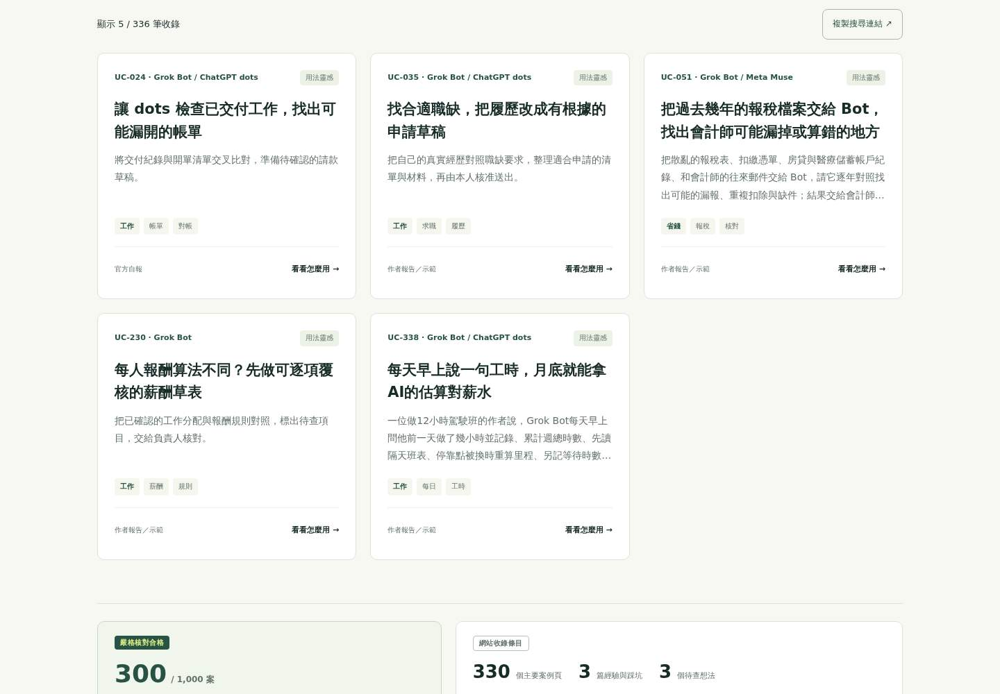
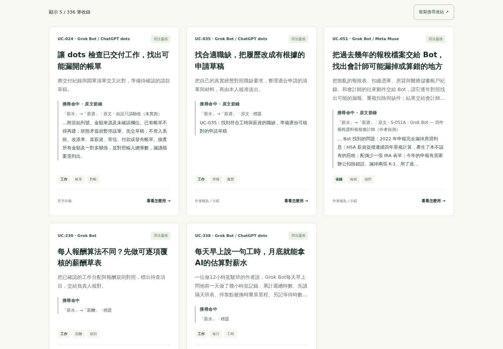
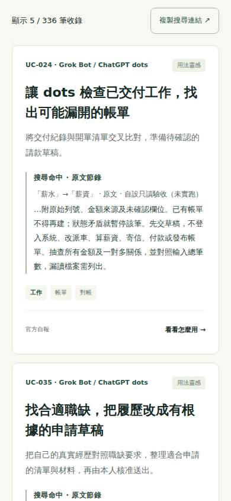

# 2026-10-18：看懂搜尋為何命中

## 問題與方案

目標讀者：用「薪水」「收件匣」「會議記錄」等日常說法找案例、需要判斷結果是否適用的人。

正式站的雲端桌面／手機走查發現：薪水 5 筆中只有 2 筆在標題或用途出現相關詞；收件匣 88 筆只有 29 筆；會議記錄 13 筆只有 6 筆。這是「卡片未顯示匹配依據」的量測，不代表其餘結果全部不相關。UC-024 因自設提示詞的「不登入系統、改派車、算薪資」命中薪水；固定摘要無法說明這個限制。

比較方案：

- 調整排序：可把主要用途相關案例提前，但需要建立相關性樣本與排序回歸，成本較高，也會改變既有結果順序。
- 顯示命中依據（採用）：成本中等，在原卡片顯示查詢與實際命中詞、欄位或原文章節；深文命中附原文節錄，讓人先判斷再開啟。

驗收：同義詞、多詞分散、原文標題、頁首資料、URL-only、ID 別名、Unicode、長文字都可說明；原文及查詢安全顯示為文字。無查詢與抽卡不增加區塊；搜尋、組合篩選、空結果、直鏈／重整、返回與焦點保留。每卡至多兩項說明，其他關鍵字以數量提示；每段節錄最多 96 Unicode code points（不含省略號）。

不處理：搜尋排序、同義詞、研究內容、難度分類、去重、證據資格、框架與部署方式。300 嚴格核對合格與 336 總條目保持分開；未修改案例或協作者研究。

## 實作與前後畫面

- `assets/app.js`：沿用既有匹配規則產生欄位／章節說明，NFKC 匹配後映回原始文字位置；使用 `textContent`，不執行來源 HTML。只有搜尋結果卡片接收查詢。
- `assets/style.css`：沿用品牌文字與細邊線；區塊可換行，沒有新動畫。
- `tests/search-context.test.cjs`、`tests/search-context-browser.cjs`、`tests/match-baseline.cjs`、`tests/search-context-live.cjs`：單元、基準、跨瀏覽器及部署驗收。
- `.github/workflows/search-context-qa.yml`：既有 GitHub Ubuntu runner、唯讀 token；PR／main 自動驗證，正式站僅額外載入兩次整庫。
- 本文件與 `SITE.md`：維護紀錄。

同一資料基準與查詢「薪水」，從結果數位置拍攝；桌面 1440×1000、手機 390×844。前圖為 `0d8cbf1`，後圖為 `8bef9478`；後續驗收腳本修改沒有改這些產品資產。

| | 修改前 | 修改後 |
|---|---|---|
| 桌面 |  |  |
| 手機 |  |  |

[正式搜尋預覽](https://richardhan.github.io/ai-agent-use-cases/?q=%E8%96%AA%E6%B0%B4#explore) · [PR #44](https://github.com/RichardHan/ai-agent-use-cases/pull/44) · [原始驗收數據](verification.json)

## 已取得的驗收證據

- [原有基準](https://github.com/RichardHan/ai-agent-use-cases/actions/runs/39129881373)：27/27 測試、Node 語法、Python 預覽建置成功；實際桌面／手機走查。
- [先紅](https://github.com/RichardHan/ai-agent-use-cases/actions/runs/39130023423)：27 pass / 4 fail，缺少搜尋說明函式。
- [96 字版本](https://github.com/RichardHan/ai-agent-use-cases/actions/runs/39130352127)：31/31 測試、語法、預覽建置成功；Chromium 1440／390／320px、Firefox 390px、WebKit 390px 三情境全部通過。10 次 axe 掃描（同義詞節錄／長文字兩狀態）零違規。
- 新版三個查詢的每筆結果都有匹配說明：5/5、88/88、13/13。完整 ID 順序記錄於 verification.json。
- 該次 runner 的 fill＋render 完成樣本 19–87ms；涵蓋 5–88 筆結果，非節流環境、非 LCP、非真實手機效能，也沒有主張速度提升。
- 第一版 `33dc62d` 在 WebKit 長文字狀態遇到原有 chip 色彩切換對比失敗；協作者 PR42 合併後，安全整合 `54a4cf5`，沒有以移除 axe 掃描規避。整合後與 96 字版皆通過。
- 外部連結走查：瀏覽器開啟 UC-024 的 GitHub Markdown 原文取得 HTTP 200；另透過雲端網頁讀取開啟該案例的 [OpenAI 原始來源](https://openai.com/index/introducing-dots/)。未聲稱已重現案例成果或逐一核查全部來源。
- 既有 Website QA／Reader QA 另檢查整庫閱讀、來源導航、長內容、載入失敗／重試、無資料、分享、鍵盤與 base path；最新整合及正式 Pages 結果以 PR checks 與 main 的對應執行為準。
- 永久部署驗收先等待 app.js／style.css 與 checkout 相同，再比較瀏覽器實際 response body，避免只驗證旁路 fetch。正式站只跑桌面／手機各一次整庫載入；詳盡邊界留在雲端預覽。

三種模擬走查（不是真人偏好或轉換研究）：

1. 搜尋薪水 → 讀 UC-024 同義詞與禁止算薪資的節錄 → 鍵盤開詳情／全文 → Escape 回原卡片。
2. 收件匣＋Grok Bot＋工作 → 改成無結果詞 → 回搜尋框修正並保留篩選 → 直鏈重新整理 → 關閉／瀏覽器返回，核對結果 ID 與焦點。
3. 旅遊＋收件匣＋權限的分散匹配 → 顯示兩項和剩餘數量 → 長 Unicode／HTML 字串只顯示文字、不溢出 → 清除查詢移除說明。

## 重現指令

```sh
node --test tests/*.test.cjs
node --check assets/app.js
node --check assets/reader.js
python3 scripts/preview.py /tmp/search-context-preview/ai-agent-use-cases
python3 -m http.server 8084 --directory /tmp/search-context-preview
NODE_PATH=<cloud-browser-tools>/node_modules node tests/search-context-browser.cjs
MATCH_LIVE_URL=http://127.0.0.1:8084/ai-agent-use-cases/ NODE_PATH=<cloud-browser-tools>/node_modules node tests/search-context-live.cjs
```

測試工具沿用 Playwright 1.64.1／axe 4.10.2，只裝在雲端 runner。網站無新增 runtime 依賴、追蹤器、cookies、帳號、付費 API 或第三方資料傳送。沒有獨立 lint／TypeScript／npm build；Python 預覽模擬 catalog，正式 Jekyll 需另查 Pages 部署。

## 獨立審查與限制

未負責實作的角色透過 GitHub 審查 `b432bb15` 與 `38071484`，未發現產品功能或安全阻擋。依建議補上 H1 後頁首資料標籤回歸、明示節錄性質，並補瀏覽器實際資產比對；主代理為唯一整合者。

原文節錄仍可能截去較遠的否定、時間或來源限制，不能當完整事實摘要；需開啟全文判讀。URL-only 匹配會保留 URL 文字，沒有改變現有寬鬆匹配。未執行實體 iPhone／Safari、讀屏器或真人研究；axe 零違規不等於完整無障礙認證。

主代理實際模型 ID／推理強度及帳號最高選項沒有可驗證或切換介面；未宣稱使用最強模型。獨立審查工具指定 `gpt-6-astra / ultra`。沒有另行付費 API 或購買額度。

執行開始只做 `pwd` 確認路徑後，即停用本機 shell／GUI；後續全部透過 GitHub 連線、已存在的雲端 Actions 與雲端網頁讀取。未修改本機工作樹，也未宣稱能確認其未提交內容。遠端未找到 AGENTS.md；以 README、SITE.md、既有腳本及工作流程為準。基準 `0d8cbf1` 已包含 PR43，後續合併 PR42 的 `54a4cf5`；無 reset、強推或協作者檔案覆蓋。

下一輪：建立少量有明確相關性判準的查詢樣本，再評估「主要用途命中優先」排序；避免繼續增加同義詞造成過度召回。
