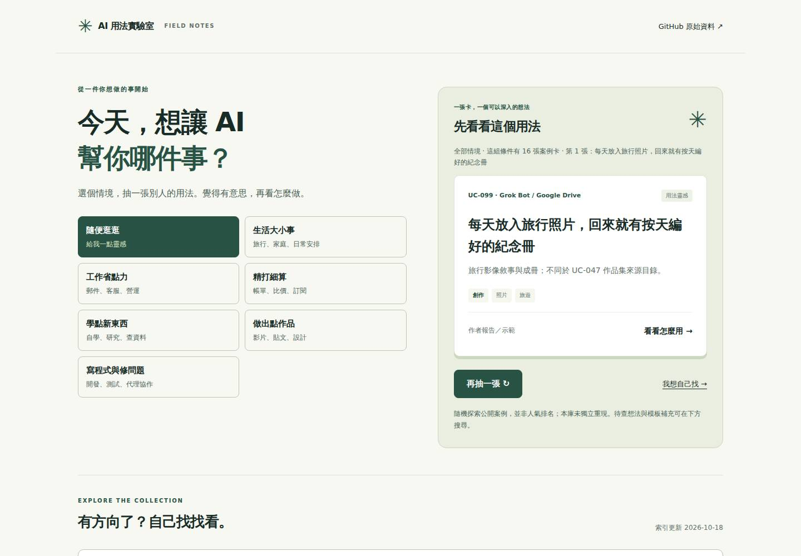
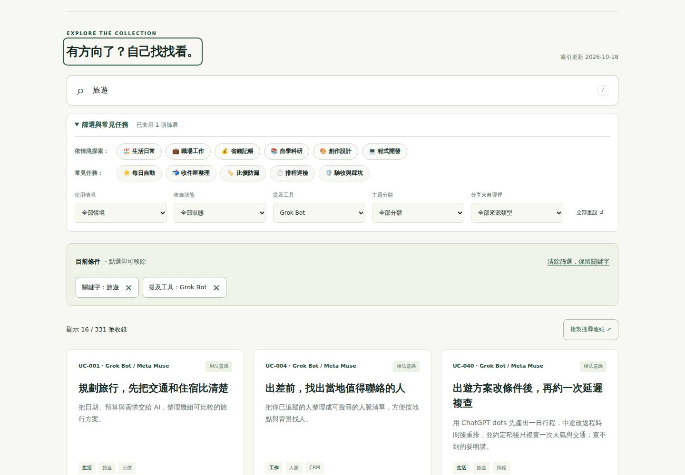
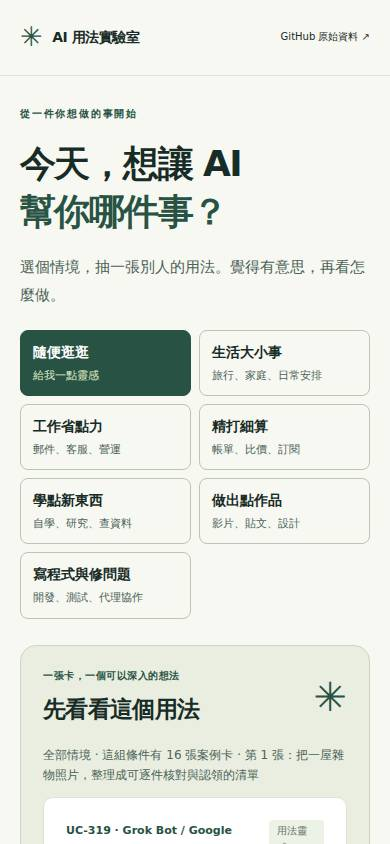
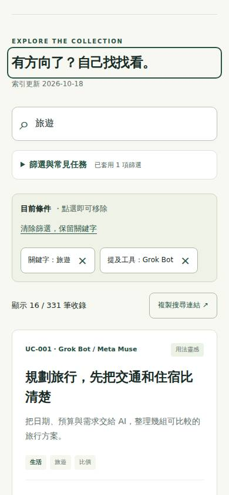

# 2026-10-18：分享搜尋與回到結果

## 問題、選擇與範圍

目標讀者：收到朋友的案例搜尋連結、收藏搜尋條件後回訪，或直接開啟案例再想看其他結果的人。

正式站雲端 Chromium 實測 `?q=旅遊&tool=Grok%20Bot`：桌面與手機都停在首頁探索區，搜尋條件已套用卻在首屏外。390px 的結果數位於 1,874px；直接案例關閉後焦點在 `draw-case`。這不是真人研究，也沒有量測留存或轉換。

比較方案：
- 只修直鏈落點：成本低，能縮短回訪路徑，但分享仍仰賴手動複製網址。
- 完成分享與返回流程（採用）：成本中等，增加可找到的複製入口、失敗備援、搜尋落點與案例返回，讓發送者和收件者都能完成任務。

驗收：分享保存關鍵字與五個篩選、移除案例及無關 URL 參數；搜尋直鏈與重新整理落在搜尋區；直接案例仍優先開啟，關閉回結果；站內開啟仍返回原按鈕；支援空結果、長輸入、剪貼簿失敗／不存在／非同步舊回應、錯誤重試、鍵盤與窄螢幕。一般首頁、其他明確 hash 與搜尋載入期間的主動操作不被自動搜尋落點覆蓋。

不處理：研究資料、同義詞、證據判定、案例去重、難度分類、框架及部署方式。明確 `?case=` 連結仍在內容載入後開啟指定案例；手動操作保護針對搜尋落點，不取消此既有直鏈語意。

## 變更

- `assets/app.js`：搜尋分享 URL 白名單、複製成功與手動備援、過期非同步回應防護；搜尋到達與案例關閉焦點；重試先把焦點移至持續存在的狀態。
- `index.html`、`assets/style.css`：結果數旁分享按鈕、可選取網址與狀態、搜尋標題焦點。延續綠色品牌與原生控制。
- `tests/arrival.test.cjs`：URL 與到達意圖回歸。
- `tests/arrival-browser.cjs`、`tests/arrival-baseline.cjs`：三種情境、前後截圖、座標、axe、載入／複製邊界。
- `tests/reader-browser.cjs`、`tests/reader-baseline.cjs`：接入既有跨引擎雲端驗收，並修正 baseline helper 呼叫。

網站沒有新增第三方請求、儲存、追蹤器或 npm 依賴。app.js 由 35,845 增至 38,714 bytes；這是原始檔大小，不是效能分數。325 主要案例、331 總條目與 296 嚴格核對計數保留；沒有刪改案例、來源或協作者內容。

## 前後畫面與量測

同一查詢、同一 Chromium viewport，Y 座標相對視窗上緣；首次抽卡隨機，原首頁高度會隨抽卡文字稍變。這些數字是記錄的樣本，非所有載入的固定值。

| 視窗 | 修改前結果數 Y（正式站） | 修改後結果數 Y（預覽） |
|---|---:|---:|
| 1440 × 1000 | 1502 | 683 |
| 390 × 844 | 1874 | 510 |
| 320 × 740 | 2042 | 562 |

| | 修改前 | 修改後 |
|---|---|---|
| 桌面 |  |  |
| 手機 |  |  |

[直接案例關閉後](return-mobile.jpg) · [保留條件的空結果](empty-mobile.jpg) · [原始量測](verification.json)

## 實際驗收

- 原有基準：24/24 通過；既有 Chromium 三尺寸流程與 axe 通過。
- 先紅：667b127 的 [Website QA](https://github.com/RichardHan/ai-agent-use-cases/actions/runs/39125819887) 為 24 pass / 3 fail，缺少新分享／到達行為。
- 最終實作 90393a3：[Website QA](https://github.com/RichardHan/ai-agent-use-cases/actions/runs/39126231359) 與 [Reader QA](https://github.com/RichardHan/ai-agent-use-cases/actions/runs/39126231397) 均 success；27/27 測試、Node 語法、Python 預覽建置通過。
- Chromium 1440／390／320px、Firefox／WebKit 390px 的三情境與邊界測試通過；新流程 10 次 axe 掃描均 0 違規。既有閱讀、手機篩選、探索、空結果測試一起通過。
- 全庫 331 條目／2,248 節／350 行證據對應通過，沒有以查詢結果數冒充案例品質。
- 本機未節流的雲端預覽 document loadEventEnd 樣本為 29–195ms，DOMContentLoaded 為 26–76ms；這些只是文件事件，不是整庫可操作時間或真實行動網路表現。原始數據在 verification.json，不聲稱速度改善。
- 初次 baseline 串接曾把輸出物件當函式呼叫而失敗；修正 helper 使用後，完整基準走查通過。屬本輪測試腳本失誤，不是網站原有失敗。
- 截圖修改前取自正式站、修改後取自最終 90393a3 雲端預覽；來源連結在同基準後續走查實際開啟 zenn.dev 文章與 GitHub 原始 issue。

三種模擬情境：
1. 收到「旅遊＋Grok Bot」搜尋連結 → 看見條件與16筆結果 → 複製 → 新收件者分頁開啟／重新整理 → 開案例 → 返回／直鏈關閉。
2. 收到「旅遊＋開發情境＋旅遊分類」空結果 → 只移除衝突情境 → 保留關鍵字並恢復結果。
3. 長關鍵字且剪貼簿被拒 → 選取手動網址；條件改動清除過期回饋；剪貼簿不存在與延遲完成亦正確處理。

另外沿用閱讀測試走查來源連結、長內容、段落導覽、原始證據、安全文字、缺選用腳本、個別案例404、copy.json失敗與整體索引錯誤。無障礙是自動化 axe 加上鍵盤操作與截圖人工檢查，不能等同完整讀屏器或真人測試。沒有 Lighthouse 分數，也沒有聲稱實體 iPhone/Safari 已驗證。

## 重現與預覽

沿用 Python 靜態預覽與 GitHub runner 既有工具：
```sh
node --test tests/*.test.cjs
node --check assets/app.js
python3 scripts/preview.py /tmp/ai-arrival-preview/ai-agent-use-cases
python3 -m http.server 8082 --directory /tmp/ai-arrival-preview
NODE_PATH=<cloud-browser-tools>/node_modules node tests/reader-browser.cjs
```

Reader QA 使用 Playwright 1.64.1、axe 4.10.2，於 GitHub Ubuntu runner 安裝；網站本身無第三方依賴。沒有獨立 lint、TypeScript 或 npm build。Python 預覽模擬 catalog，不等同正式 Jekyll；合併後須確認 Pages build and deployment，以及 Reader QA 對正式六個 assets/HTML 的逐字比對和實際流程。

[正式搜尋預覽](https://richardhan.github.io/ai-agent-use-cases/?q=%E6%97%85%E9%81%8A&tool=Grok+Bot#explore) · [PR #40](https://github.com/RichardHan/ai-agent-use-cases/pull/40)

## 獨立審查與執行邊界

獨立角色僅透過 GitHub 讀取並審查實作，主代理是唯一整合者。審查 f78f780 找出 retry 隱藏按鈕後失焦，90393a3 修正並加即時與載入後焦點斷言；第二次審查確認修正、無其他阻擋。另依建議用新收件者分頁測分享，明確界定搜尋與案例直鏈優先順序。

主代理實際模型 ID、推理強度及帳號最高可用選項未提供可查證／切換介面，故不宣稱已使用最強設定。獨立審查指定工具提供的 `gpt-6-astra / ultra`；曾遭模型容量不足，重試同設定後完成。未切換付費 API 或購買額度。

開始只讀取得工作目錄與 OpenAI Docs 技能後，因目錄為 `/Users/...` 停用本機工具。repository 讀寫、Git 分支、瀏覽與測試都改走 GitHub 連線／既有 Actions；沒有修改本機檔案或操作本機 GUI。本機未提交修改／worktree 無法在使用者限制內查驗，因此沒有宣稱本機乾淨。遠端基準 `1fc4af3`，無 AGENTS.md、無原有 open PR；新分支 `feat/shared-search-arrival-20261018`，只 fast-forward 更新自身分支，無 reset 或強推。

## 下一輪

評估從搜尋結果卡片判讀「為何符合此問題」的提示；目前全文與同義詞匹配很廣，應先量測不相關結果，再選擇摘要／匹配位置或排序改善，避免只繼續增加同義詞。
