# 2026-10-21：把單篇案例完整留作離線閱讀稿

## 問題、選擇與界線

目標讀者是已找到適用案例、需要保存長文、離線核對方法與來源的人。

本輪由整合者負責程式修改；獨立審查者以 `gpt-6-astra / ultra` 只讀審核。主對話沒有可核實其實際模型／推理或切換的介面，未宣稱已切到帳號最高模型。只在已授權 repo 路徑進行檔案／Git／Node／Python 工作；所有瀏覽器、PDF 產生與光柵化均在 GitHub Actions，未操作個人桌面、使用付費 API、購買額度。

已讀 README、SITE.md、部署 workflow、歷史 QA 與維護規則；repo 內與其父目錄未發現適用 AGENTS.md。原工作目錄仍停在 `improve/search-recall-recent-workflows-and-tokenization`，既有 `assets/app.js` 與 `tests/search.test.cjs` 未提交修改完整保留。從遠端 main `9f22923` 另建 worktree／分支；其後正常合入協作者 PR #71 的 `27fed37`，沒有衝突，未覆寫其案例／核對報告。

雲端實際走查正式站 1440×1000、390×844：首頁 → 旅遊搜尋 → 生活＋Grok Bot → 閱讀 → Escape 返回焦點 → 空結果 → UC-005 直鏈 → 開原始來源 → 列印。正式站來源實際開啟 https://zenn.dev/tec/articles/c4fbfcfffde4ad 。原有 dialog 仍限高 898px、內容 1922px、overflow:auto，印出背景整批結果，原始研究未展開。原生 PDF 桌面90頁／手機89頁，UC-005有164個原文文字節點缺漏；這不是完整閱讀稿。

兩方案：
- A，沿用詳情，增設單篇列印／存PDF入口、專用列印排版與可還原的展開狀態。成本低，保留既有直鏈與閱讀流程。**採用。**
- B，另建獨立列印頁。適合後續做專屬閱讀網址，但需維護第二套載入、錯誤及直接連結流程，本輪不採用。

驗收標準：完整印出原始研究、最後一段、證據與待查提醒、全部來源URL；排除背景、工具列與重複摘要；列印結束／取消後還原展開狀態、焦點與閱讀位置；手機／桌面、直鏈重整、返回、搜尋與空結果不退化。

不處理：案例內容／合格數／去重候選判定、搜尋演算法、獨立列印路由、品牌改色、追蹤／登入／第三方儲存。

## 變更

- `assets/app.js`：詳情「列印／存成 PDF」按鈕與輔助科技補充說明；只供列印的案例永久連結與證據提醒。永久連結清除搜尋條件與fragment，保留base path與案例ID。已顯示完整URL的來源連結不重複加括號。
- `assets/reader.js`：原生 beforeprint／afterprint 生命週期；只展開原研究，保存並還原同一節點的原開關、焦點與捲動，支援重入和連續列印。瀏覽器原生列印快捷鍵也會經過同一生命週期。
- `assets/reader.css`：單篇白底閱讀稿，移除dialog限高與捲動裁切，隱藏背景／導覽／重複先讀區；來源網址可換行、標題避免孤留頁尾，程式區可換行。
- `tests/print.test.cjs`：先紅後綠的取消／還原、已展開、重複列印與已離開節點測試。
- `tests/print-browser.cjs`、`.github/workflows/print-reading-qa.yml`：正式基準、預覽及發布資產核對、真PDF全文及URL比對、首末頁截圖、跨引擎排版與axe。

獨立審查已修正：工具列在detail-body外仍會列印；原警告被enhance移入隱藏區而遺失；非Chromium須驗正文及末段的rendered height；workflow須納入app.js/index.html/style.css依賴。

測試程序亦修正兩個問題：axe需顯式browser.newContext；連續page.pdf之前須清除先前screen media override。失敗均保留於Actions紀錄，未將其當成產品驗收成功。

## 驗證方式與限制

本機基準：`node --test tests/*.test.cjs`，136/136通過。新增後／合入最新研究後：139/139通過。`for file in assets/*.js; do node --check "$file"; done`與`git diff --check`通過。`python3 scripts/preview.py /tmp/print-round-final/ai-agent-use-cases`成功；前端沒有獨立lint、TypeScript或npm build，此預覽不等於Jekyll正式部署。

本輪開始前已有兩筆歷史正式站CI失敗：[Reader controls QA 39526478816](https://github.com/RichardHan/ai-agent-use-cases/actions/runs/39526478816) 等待首張結果卡逾時；[Improvement round QA 39526478803](https://github.com/RichardHan/ai-agent-use-cases/actions/runs/39526478803) 在部分來源尚未載入時不符合「已載入」斷言。這些是本輪之前的紀錄，未宣稱已由列印改善修復。全文載入成本仍是下一輪優先題。

紅測試在固定 `9f22923` 的 reader.js 執行3項新測試，全失敗（`createPrintSession is not a function`）；修正後3/3通過。

三種模擬情境：
1. 想找旅遊方法：搜尋＋組合篩選、閱讀、Escape回原卡焦點、保留查詢、空結果。
2. 保存最長開發案例UC-005：直鏈、重整、打開外部來源、完整多頁PDF、原生列印還原，再次列印。
3. 辨別風險：UC-313失敗敘述、P-003待查線索；原文／限制／來源及非成功提醒必須出現在離線稿。

Chromium：1440／390，各測UC-005、UC-313、P-003，產生實際A4 PDF。以pdftotext逐個比對原文文字節點和完整URL，再用pdftoppm檢視首末頁。Firefox／WebKit：390、UC-005，檢查print media、原研究及末段可見性、模擬原生事件／取消還原；**沒有宣稱這兩引擎的原生PDF分頁已驗證**。可見列印按鈕以window.print stub觸發beforeprint/afterprint，真正Chromium page.pdf另驗原生事件；沒有操作OS印表機視窗或實體印表機。

這是模擬走查，不代表真人喜好或轉換率提升；axe結果也不等於完整無障礙認證。尚未做Lighthouse／節流效能分數，未捏造載入改善或分數。

第一版完整列印驗收：[Print reading QA 39543330276](https://github.com/RichardHan/ai-agent-use-cases/actions/runs/39543330276)，提交 `63d7d11`，全部通過。400個目錄來源逐一對應、402條目（396主要案例頁＋3經驗補充＋3待查），failedPaths為空；此為網站條目數，**不是嚴格核對合格案例數**。

| 引擎／尺寸 | 真正PDF | 全文文字節點 | 原文／URL缺漏 | axe |
| --- | --- | --- | --- | --- |
| Chromium 1440 | UC005 10頁、UC313 3頁、P003 1頁 | 175／41／12 | 全部0／0 | 3次均0 |
| Chromium 390 | UC005 10頁、UC313 3頁、P003 1頁 | 175／41／12 | 全部0／0 | 3次均0 |
| Firefox 390 | 未測原生PDF分頁；print media末段可見 | 原文／末段rendered height>0 | 不以此宣稱PDF全文已驗證 | 1次0 |
| WebKit 390 | 未測原生PDF分頁；print media末段可見 | 原文／末段rendered height>0 | 不以此宣稱PDF全文已驗證 | 1次0 |

全部四組均通過搜尋、組合篩選、空結果、鍵盤返回、外部來源、直鏈重整、列印按鈕、連續列印和展開狀態還原，JS pageerror皆0。原版UC005缺164／175個原文字節點與27個來源URL；修後全部保留。這是完整性結果，不能當效能或真人偏好指標。

[完整修後JSON](after-report.json) · [正式站基準JSON](before-report.json) · [原版紅測試](red.tap)。所有PDF與各引擎截圖在上述Actions artifact（保留30天），以下關鍵截圖永久納入repo。PDF頁面中的localhost網址是靜態預覽網址；正式站列印會使用同站正式網址。

| 流程 | 修改前 | 修改後 |
| --- | --- | --- |
| 桌面詳情 | 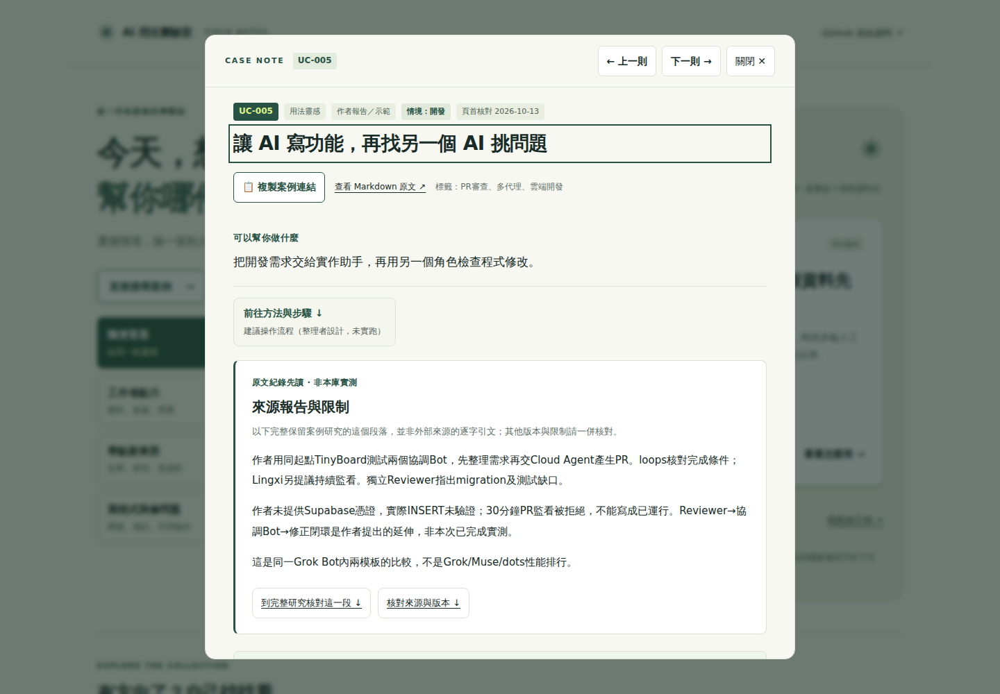 | 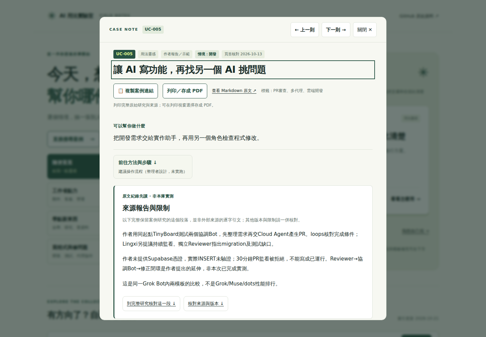 |
| 手機詳情 | 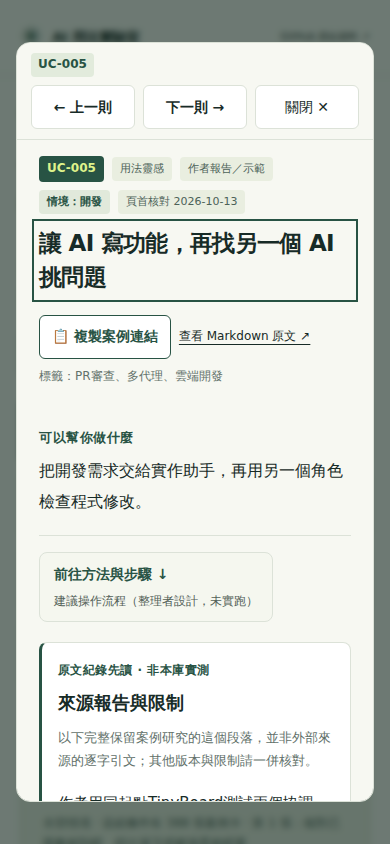 | 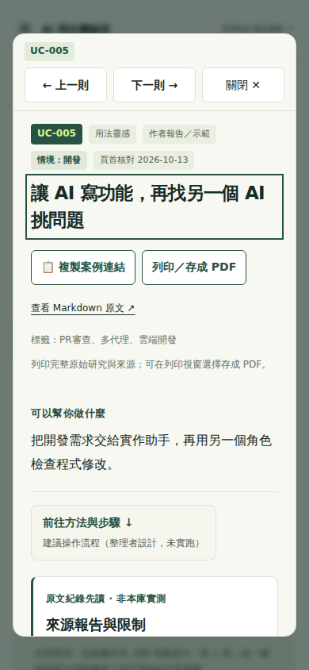 |
| 真正PDF首頁 | 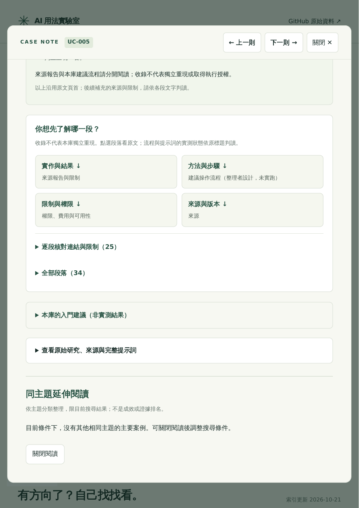 | 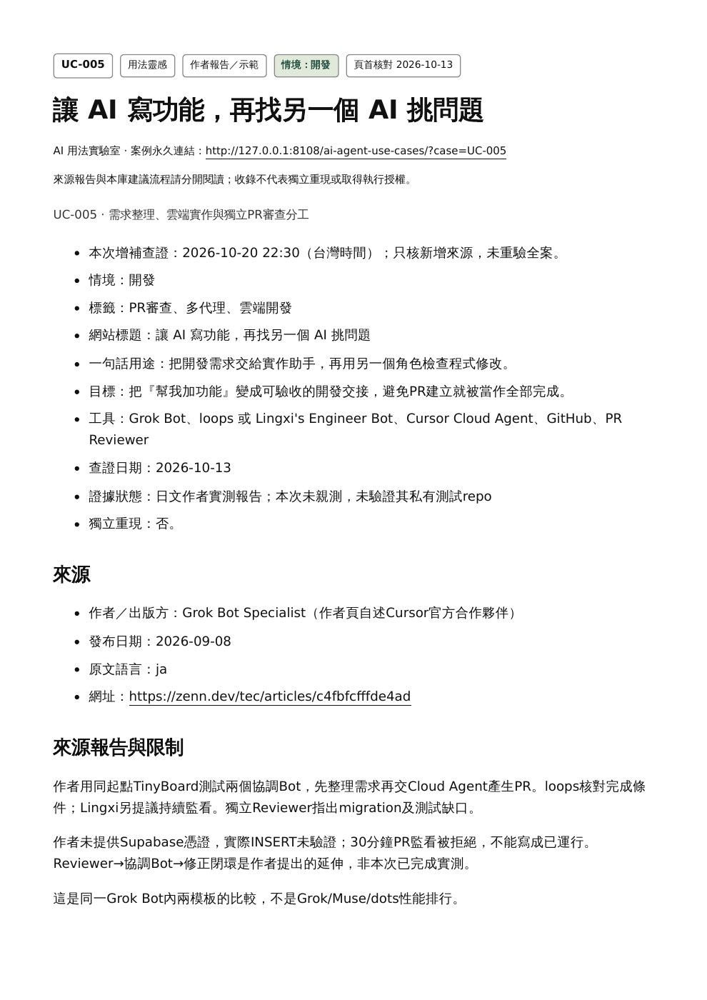 |
| 手機print media | 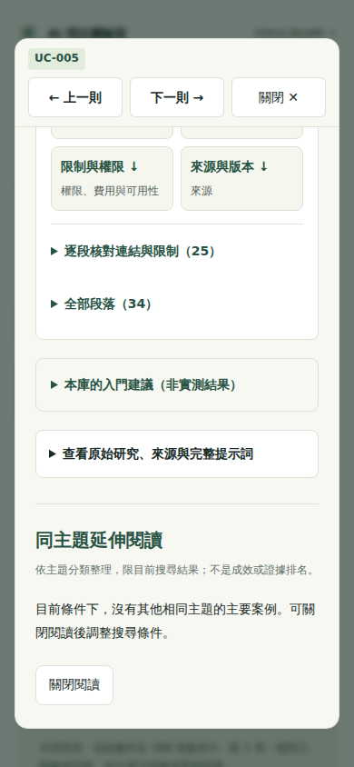 | 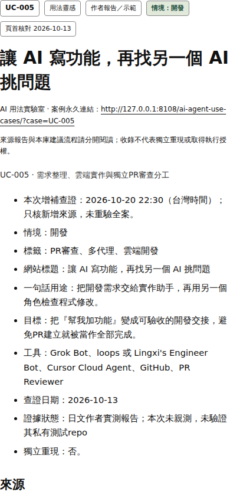 |

[最長案例的末頁](after-pdf-last.png) · [待查提醒與完整來源](after-pending.png)。

## 首屏回歸補修

第一版合併 `050493b` 後，既有 [Reading anchor QA 39543769629](https://github.com/RichardHan/ai-agent-use-cases/actions/runs/39543769629) 在UC-359兩行用途的首屏門檻失敗；[Method shortcut QA 39543769655](https://github.com/RichardHan/ai-agent-use-cases/actions/runs/39543769655) 在UC-338的方法捷徑位置門檻失敗。新增列印操作與可見輔助段落增加窄螢幕標題區高度，這是本輪導致的真實回歸，不能歸為原有CI失敗。最初專用驗收沒有覆蓋這兩個幾何門檻，合併後已補修與擴充驗收。

640px以下使用緊湊操作標籤：複製案例連結／列印PDF／Markdown；列印完整說明供輔助科技讀取，避免擠壓首屏。複製仍保留完整原可見名稱及aria-label；列印由目前可見span提供名字，避免Label in Name失配。axe加入wcag21a，並以getByRole的精確名稱檢查桌面／手機。

專用workflow補跑既有測試，保留原斷言，不放寬首屏標準：

```sh
ROUND_URL=http://127.0.0.1:8108/ai-agent-use-cases/ node tests/round-browser.cjs
METHOD_URL=http://127.0.0.1:8108/ai-agent-use-cases/ node tests/method-shortcut-browser.cjs
SHARE_URL=http://127.0.0.1:8108/ai-agent-use-cases/ node tests/case-share-browser.cjs
```

前兩個讀寫流程已於 [39544107524](https://github.com/RichardHan/ai-agent-use-cases/actions/runs/39544107524) 通過；最終含名稱、分享成功／手動fallback／遲到回應的整輪於 [39544294774](https://github.com/RichardHan/ai-agent-use-cases/actions/runs/39544294774)（`cdcae60`）全通過：

- print：四組，400來源／402條目完整；六真PDF原文／URL缺漏0；8次axe為0（包含wcag21a與精確可及名稱斷言）。
- 閱讀：Chromium1440／390／320／480全部完成；長標題兩行用途、背景完成後閱讀位置、錯誤補讀、待查、重新整理／返回保留原斷言；8次axe為0。
- 方法：Chromium1440／390／320＋Firefox／WebKit390，5組均通過；390捷徑位於643–713px，320保留完整用途且可短滑抵達；5次axe為0。
- 分享：三引擎五組尺寸，成功／fallback／操作焦點通過；另7種遲到回應／缺Clipboard API狀態全過，真Chromium剪貼簿讀回通過；15次axe為0。

以上共36次axe掃描0違規，各suite的實際覆蓋仍以腳本tags為準，不宣稱全面無障礙認證。Node139/139持續通過。獨立審查已複核程式、四份報告與最終手機圖並簽核，補修合併為 `f1a801f`。

[閱讀完整JSON](round-verification.json) · [方法完整JSON](method-verification.json) · [分享完整JSON](sharing-verification.json)。

| 320px長標題：前兩行用途可見 | 390px方法捷徑：首屏可操作 |
| --- | --- |
| 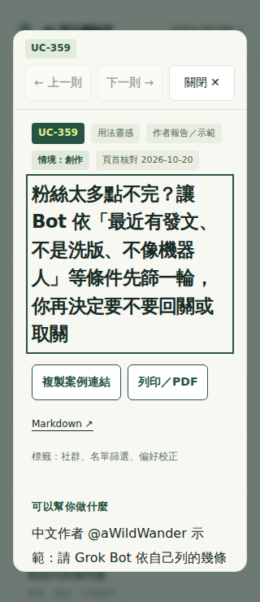 | 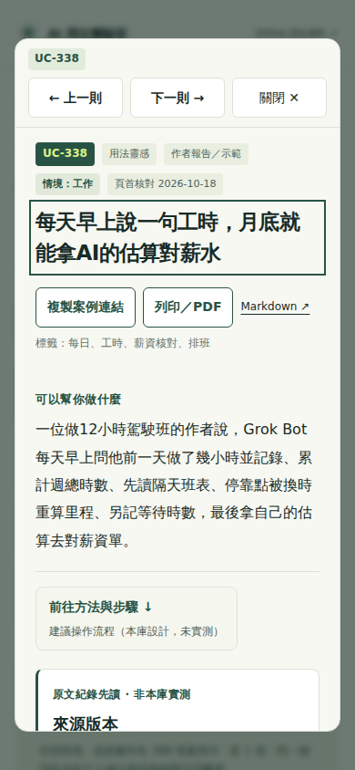 |

第一版發布的專用run39543769737曾因Pages部署排隊超過180秒而等待失敗；不視為已發布成功。初版Pages實際建置／部署於 [39543769295](https://github.com/RichardHan/ai-agent-use-cases/actions/runs/39543769295) 成功。補修版 **`f1a801f7f24aad3da2cafcbc04cfaa6c08578732` 已正式上線**：[Pages建置與部署39545167110](https://github.com/RichardHan/ai-agent-use-cases/actions/runs/39545167110) 與 [正式站完整驗收39545167747](https://github.com/RichardHan/ai-agent-use-cases/actions/runs/39545167747) 均成功。正式站逐檔回應文字與checkout完整相等後，才走查三引擎／桌面手機、來源、搜尋、篩選、空結果、直鏈重整、返回、列印還原與六份真PDF。400來源／402條目完整、pageerror0、六份PDF全文與URL缺漏0；正式站另8次axe0，加同run預覽36次共44次0。

[正式站JSON](published-report.json) · [發布提交與資產SHA-256](release-verification.json)。未測實體印表機、實機Safari／Firefox原生分頁；正式站源碼比對與Chrome真PDF是已測結果。

| 正式站桌面 | 正式站手機 |
| --- | --- |
| 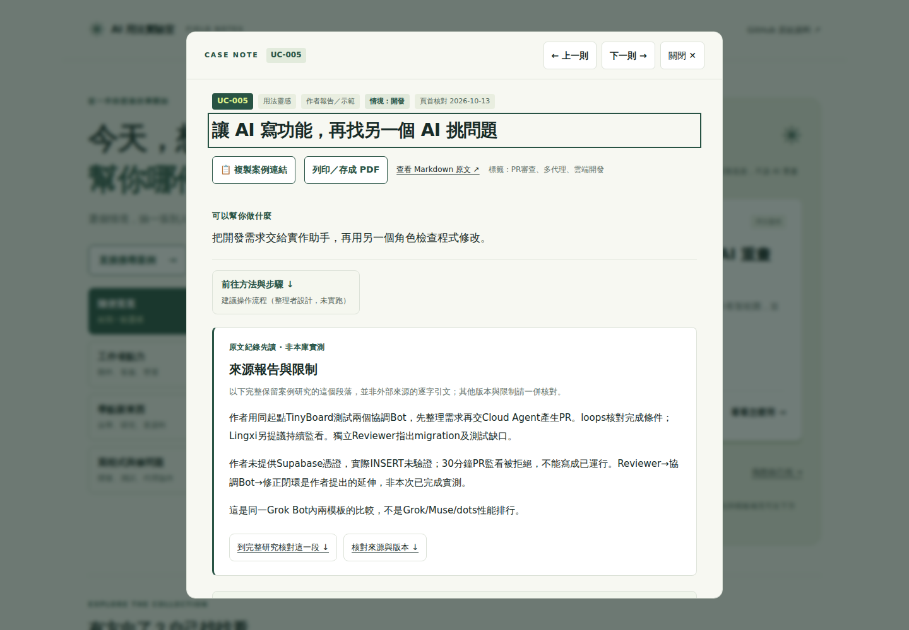 | 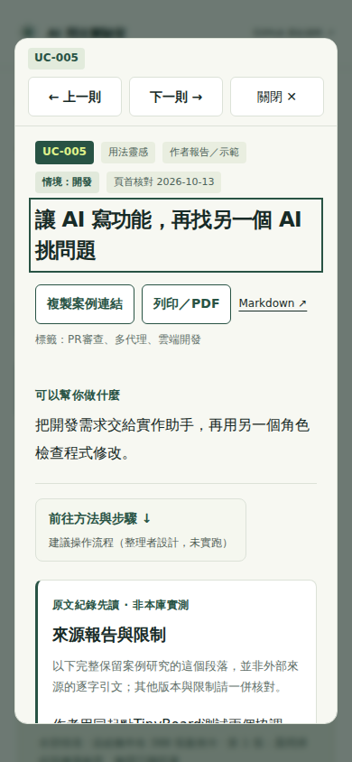 |

[正式站PDF首頁（正式永久網址）](published-pdf-first.png) · [正式站PDF末頁](published-pdf-last.png)。

## 廣域CI未解項（不宣稱全部CI綠燈）

獨立審查另逐筆核對本發布提交13筆廣域CI失敗：

- 8筆未進入新版正式功能驗收：Category finding39545167532、Search relevance39545167662、Home search entry39545167613、Search context39545167529、Partial Load39545167580、Facet counts39545167598、Available facet39545167522、Recent review39545167483。資產／catalog等待於04:42:59–04:47:23 UTC結束，早於Pages deploy step於04:47:35 UTC完成；確認是部署排隊超出各自等待上限。
- [Improvement round39545167637](https://github.com/RichardHan/ai-agent-use-cases/actions/runs/39545167637)：桌面已完成，手機UC359主文件HTTP429，診斷另記377次429與1次503；[Reader context39545167555](https://github.com/RichardHan/ai-agent-use-cases/actions/runs/39545167555)：主文件HTTP429；[Reader controls39545167707](https://github.com/RichardHan/ai-agent-use-cases/actions/runs/39545167707)：1440／390／320已完成，360截圖明示GitHub Pages Rate limit exceeded。這3筆有實際限流證據，未認定成新尺寸／名稱退化。
- **根因仍未知**：[Combined recovery39545167723](https://github.com/RichardHan/ai-agent-use-cases/actions/runs/39545167723) 的公開Chromium1440／390／320完成，但Firefox首頁缺少copy-search-link；[Evidence round39545167667](https://github.com/RichardHan/ai-agent-use-cases/actions/runs/39545167667) 的review-sections五配置與reader-search桌面完成，但手機UC024直鏈等詳情逾時。沒有HTTP診斷，保留FAIL，不逕稱429或已修復。

本輪的專用正式站驗收成功，不取代以上未解項。下一輪需先補齊失敗頁HTTP診斷，量測全文載入成本與CI並行負載，再決定如何改善載入可靠度；不要靠放寬斷言或捏造成功掩蓋限流。

## 預覽與下一輪

部署後開 https://richardhan.github.io/ai-agent-use-cases/?case=UC-005 ，使用「列印／存成 PDF」。開發預覽：`python3 scripts/preview.py /tmp/ai-print-preview/ai-agent-use-cases`，再`python3 -m http.server 8108 --directory /tmp/ai-print-preview`，進入 `/ai-agent-use-cases/?case=UC-005`。

下一輪最值得做：針對實際429／未明逾時補齊HTTP診斷、量測全文載入與CI並行負載，改善首次與回訪載入可靠度。避免再重做已完成的來源導覽、分類搜尋或列印版面。
