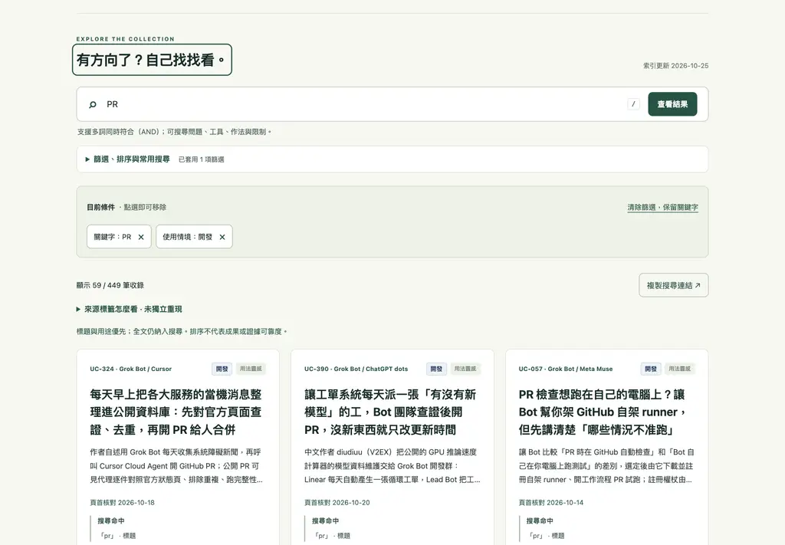
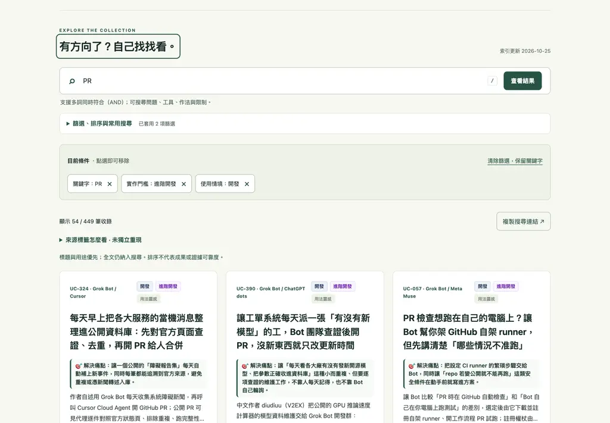
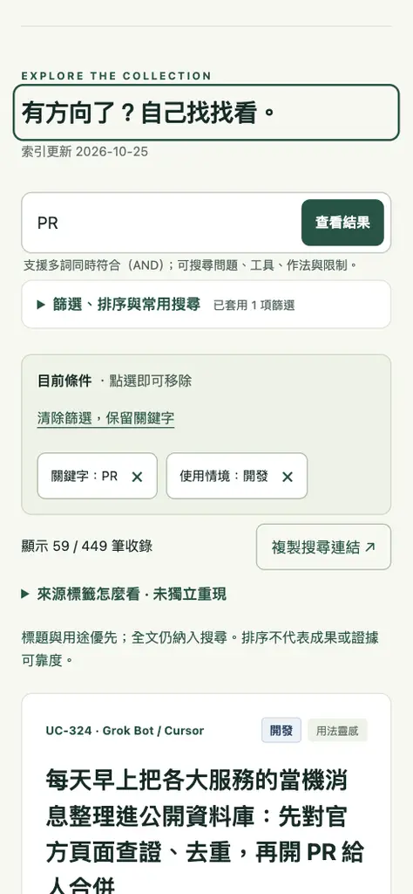
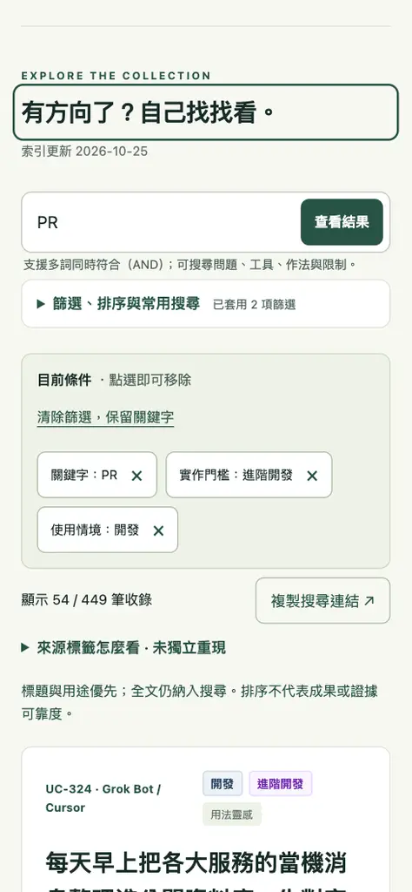

# 2026-10-25 搜尋頁籤標題納入實作門檻

## 問題、對象與決策

新訪客或回訪讀者以「PR + 開發 + 進階開發」搜尋時，結果與 URL 已正確套用所有條件，但瀏覽器頁籤標題漏掉「進階開發」。書籤、歷史紀錄與多分頁中因此無法辨認目前門檻條件。正式站重現：篩選 `PR`、`開發`、`進階開發` 後，標題是 `搜尋「PR」 · 開發｜AI 用法實驗室`，而非完整條件。

目標使用者：會同時開啟多個案例搜尋、分享或稍後返回的訪客。預期改善：頁籤、書籤、瀏覽歷史準確描述目前可見的搜尋條件；不改變結果、篩選 URL 或案例內容。

方案：
1. **採用：**把實作門檻納入既有頁面標題情境組合。低成本，與現有情境／工具／狀態條件一致；詳情標題仍由案例標題優先。
2. **不採用：**新增頁籤 UI 的條件摘要／麵包屑。視覺改動更大，重複現有篩選條件 chips，卻無法修正書籤與瀏覽歷史標題。

不處理：Actions 流程、案例資料、搜尋排序、視覺重設或其他標題條件。本輪僅修正頁面標題描述已存在的難度篩選。

## 修改

- `assets/app.js`：`syncPageContext()` 將 `difficulty` 傳入 `pageContextTitle()`；標題組合將其列為活動條件。
- `tests/page-context.test.cjs`：驗證單獨難度與關鍵字＋情境＋難度的標題。
- `tests/page-context-browser.cjs`：驗證真實篩選、難度直接連結還原、標題正確性。

## 截圖與預覽

截圖：

| 視口 | 修改前 | 修改後 |
|---|---|---|
| 桌面 1440×1000 |  |  |
| 手機 390×844 |  |  |

畫面本身不變，改進在瀏覽器標題列與歷史／書籤標籤（自動化瀏覽器截圖不包含瀏覽器原生標題列）。正式站修改前搜尋標題為 `搜尋「PR」 · 開發｜AI 用法實驗室`；分支預覽修改後為 `搜尋「PR」 · 開發 · 進階開發｜AI 用法實驗室`。桌面與手機分支驗證均無水平溢出。詳情返回截圖見 `screenshots/after-detail-return.webp`。

本機預覽：

```sh
python3 scripts/preview.py /tmp/ai-usecase-title-preview/ai-agent-use-cases
python3 -m http.server 8130 --directory /tmp/ai-usecase-title-preview
```

網址：`http://127.0.0.1:8130/ai-agent-use-cases/?q=PR&scenario=開發&difficulty=進階開發`。GitHub Pages 靜態 base path 保留。

## 驗收與三種情境

- `PR` + `開發` + `進階開發`：54 筆；標題完整列出三項搜尋條件。
- 直鏈 `?q=PR&scenario=開發&difficulty=進階開發&case=UC-324`：詳情標題仍優先顯示 UC-324 標題；Escape 返回後恢復完整搜尋標題，焦點回到結果計數。
- 手機 390px：同一多條件搜尋標題正確；文件寬度等於視口，無水平溢出。
- 修改前基準：`node --test tests/*.test.cjs` — 324/324 通過。Pages 相容預覽與 `scripts/check_corpus_bundle.py` 通過，447 sources byte-for-byte identical。正式 Jekyll CLI 不存在於此環境（Ruby 2.6.10，`jekyll: command not found`）。
- Actions：前版 `c4db9d8` 的 Round 23 與 Reading anchor workflow 曾失敗，但完整失敗 log 不可讀，未推測根因；其後 `9a13b24` 的 Round 23 acceptance QA 為成功。這一輪沒有修改 workflow，新增 browser test 會於既有 CI Playwright job 執行。
- 來源走查：UC-324 原始 X 貼文可正常開啟；同頁列出的 `tomoyk/failure-reports` GitHub 連結回傳 GitHub 404，未改動原始案例資料，留待來源維護時核查。

瀏覽器走查是自動化檢查，不代表真人偏好或轉換率改善。

## 獨立審查

初審發現並修正 3 個問題：加入難度時遺漏舊有情境／狀態／工具／分類 facets；browser test 使用結果有資料時隱藏的 empty-state reset；手機頁面新載入後篩選 `<details>` 可能收合。修正為保留原 facets、用 base URL 重設，並在手機驗收前展開篩選面板。最終複核待完成。

## 風險與下一步

本機環境沒有 Playwright／axe 套件，無法在此直接執行 `tests/page-context-browser.cjs`；已用實際 Chromium browser 工具走查修改前正式站與本機 Pages 預覽。需由本輪 Actions 確認永久 browser test。正式 Jekyll build 亦未能在本機執行。下一輪優先查明 Actions workflow 對主線新提交的失敗日誌，僅在可證實根因後修正，不把部署延遲或未知錯誤當作已解決。
